  
   
  

### `> player profile`

I'm Nagendra, an **AI & full-stack software engineer** in San Francisco and a Computer Science graduate of **Texas Christian University**. I build agents, retrieval systems, and the full-stack products around them. I work in Python, TypeScript, FastAPI, React, and PostgreSQL.

**Current mission:** find a software engineering team building useful AI products. I'm on **F-1 OPT** and will need future H-1B sponsorship.

`[ PLAYER 01 ]` · `[ SAN FRANCISCO ]` · `[ BUILD MODE: ON ]`

### `> mission select`

| Quest | What I'm building | Explore |
|:--|:--|:--|
| **01 / Wisper** | An agentic automation engine with approvals, durable workflows, and audit trails. TypeScript, PostgreSQL, Temporal. | [View code](https://github.com/nagendrachaudhary99/Wisper) |
| **02 / SafeMap** | A San Francisco parking finder with a live garage feed, map, street rules, and a handoff for payment. | [View code](https://github.com/nagendrachaudhary99/SafeMap) |
| **03 / ProxyEval** | My LLM evaluation project. Follow along as it develops. | [View code](https://github.com/nagendrachaudhary99/Proxyeval) |

> **MAIN QUEST** Build systems that work outside the demo. **SIDE QUEST** Make the interface worth opening twice.

### `> unlocked tools`

`Python` · `TypeScript` · `FastAPI` · `React` · `PostgreSQL` · `Temporal` · `AI agents` · `RAG`

### `> scoreboard`

<!-- These cards are generated by the stats workflow after the first push. Numbers are from GitHub, not fabricated. -->

  
  
   
  

### `> daily quest: the contribution maze`

<!-- The daily workflow publishes this genuine contribution animation to the output branch. -->

  <picture>
    <source media="(prefers-color-scheme: dark)" srcset="https://raw.githubusercontent.com/nagendrachaudhary99/nagendrachaudhary99/output/github-snake-dark.svg" />
    
  </picture>
   
  Each tile comes from my actual contribution graph. No generated commits.

### `> team up`

[See my repositories](https://github.com/nagendrachaudhary99?tab=repositories) · [Email me](mailto:nagendrachaudhary0308@gmail.com)
