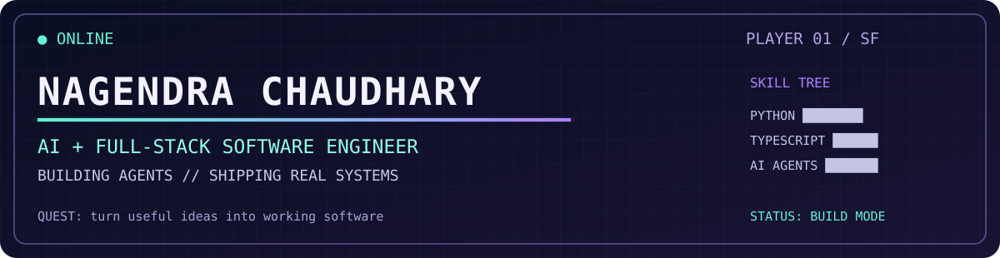

  
   
  

### `> player profile`

I'm Nagendra, an **AI & full-stack software engineer** in San Francisco and a Computer Science graduate of **Texas Christian University**. I build agents, retrieval systems, and the full-stack products around them. I work in Python, TypeScript, FastAPI, React, and PostgreSQL.

**Current mission:** find a software engineering team building useful AI products. I'm on **F-1 OPT** and will need future H-1B sponsorship.

`[ PLAYER 01 ]` · `[ SAN FRANCISCO ]` · `[ BUILD MODE: ON ]`

### `> completed quests: shipped products with real users`

| Quest | What it is | Proof |
|:--|:--|:--|
| **Quipler** | Student-built product, co-founded and shipped. | **500+ real users**, **~$10.3K TCU CREATE funding** · [quipler.app](https://quipler.app) |
| **FasterFlow** | AI desktop overlay that reads on-screen content and answers questions directly over your active application. | Live product with real users · [fasterflow.co](https://fasterflow.co) |

### `> boss fights: deep engineering builds`

| Quest | What it proves | Explore |
|:--|:--|:--|
| **ResolveDesk** | AI support-resolution platform: policy-grounded replies with verified citations, human-in-the-loop for money movement, crash-safe and idempotent execution. **30/30 tests on real Postgres** (incl. crash-mid-refund), eval harness (routing **100%**, citation match **91%**), 500-ticket load test. Tickets are synthetic and the README says so. | [View code](https://github.com/nagendrachaudhary99/resolvedesk) |
| **ProxyEval** | LLM evaluation harness on **8 real SEC DEF 14A filings** with **31 hand-checked gold labels**. Found a real parser failure, fixed it, locked it in with a regression test: critical-field accuracy **82.6% -> 91.3%**. | _(code publishing soon)_ |
| **Blackbox** | AI on-call incident investigator: turns raw outage logs into an evidence-cited timeline, ranks root-cause hypotheses against runbooks, drafts the postmortem. **50 tests**, honest eval scores, synthetic incidents disclosed. | [View code](https://github.com/nagendrachaudhary99/blackbox) |
| **blaze-payment-guard** | Verification layer between money-moving AI agents and execution: duplicate, over-amount, currency, and unreferenced-payment checks, each carrying the amount at stake. | [View code](https://github.com/nagendrachaudhary99/blaze-payment-guard) |

### `> side quests`

| Quest | What it is | Explore |
|:--|:--|:--|
| **AudioComics** | **3rd place, Murf Falcon Buildathon.** Turns comic pages into multi-voice audio stories with character emotion (OpenAI Vision + Murf AI, 10+ languages). | [View code](https://github.com/nagendrachaudhary99/Audiocomics-Murf-AI) |
| **sel-sensor-hub** | C11/C++17 sensor data pipeline: ring queues, CRC-16 packet protocol, fixed-point filters, lock-free SPSC queue. **141 unit checks + 100k-case deterministic fuzzing** under ASan/UBSan. | [View code](https://github.com/nagendrachaudhary99/sel-sensor-hub) |
| **SafeMap** | San Francisco parking-safety map built on live SFMTA and police incident data. Started after my own scooter was stolen. _(in progress)_ | [View code](https://github.com/nagendrachaudhary99/SafeMap) |
| **Wisper** | Agentic automation engine: conversational control, durable workflows, approval-gated actions, audit trail. TypeScript monorepo + PostgreSQL + Temporal. _(in progress)_ | [View code](https://github.com/nagendrachaudhary99/Wisper) |

<b>More builds</b> - evaluation harnesses and safety gates for AI agents

- [rational-ledger-recon](https://github.com/nagendrachaudhary99/rational-ledger-recon) - reconciliation and anomaly-detection gate for zero-human accounting
- [lemonlime-outbound-qa](https://github.com/nagendrachaudhary99/lemonlime-outbound-qa) - pre-send quality gate for agent-drafted outbound messages
- [pluto-profile-fidelity](https://github.com/nagendrachaudhary99/pluto-profile-fidelity) - fidelity measurement for voice-interview profile extraction, with hallucination and omission detection
- [neuromorphic-instruction-gateway](https://github.com/nagendrachaudhary99/neuromorphic-instruction-gateway) - safety gateway between natural-language commands and lab robots
- [quora-answer-quality-eval](https://github.com/nagendrachaudhary99/quora-answer-quality-eval) - offline eval harness for an LLM content-quality agent: precision/recall/F1, latency, cost
- [sirenopt-sensor-pipeline](https://github.com/nagendrachaudhary99/sirenopt-sensor-pipeline) - multi-sensor acquisition-to-storage pipeline in modern C++17

> **MAIN QUEST** Build systems that work outside the demo. **SIDE QUEST** Make the interface worth opening twice.

### `> unlocked tools`

`Python` · `TypeScript` · `FastAPI` · `React` · `PostgreSQL` · `Temporal` · `AI agents` · `RAG` · `Evals`

### `> language inventory`

  

### `> daily quest: the contribution maze`

<!-- The daily workflow publishes this genuine contribution animation to the output branch. -->

  <picture>
    <source media="(prefers-color-scheme: dark)" srcset="https://raw.githubusercontent.com/nagendrachaudhary99/nagendrachaudhary99/output/github-snake-dark.svg" />
    
  </picture>
   
  Each tile comes from my actual contribution graph. No generated commits.

### `> team up`

[Portfolio](https://www.nagendrachaudhary.com/) · [LinkedIn](https://www.linkedin.com/in/nagendra-nc) · [Email me](mailto:nagendrachaudhary0308@gmail.com)
